# SDES — Smart Document Extraction & ERP Sync Pipeline

ระบบอ่านใบแจ้งหนี้ ใบกำกับภาษี และใบเสร็จด้วย AI → ตรวจความถูกต้องตามกฎบัญชีไทย → ให้เจ้าหน้าที่ตรวจทานแบบเห็นต้นฉบับคู่กัน → อนุมัติเอกสารที่มีความเสี่ยง → ส่งเข้า ERP (Odoo) เป็นใบแจ้งหนี้ผู้ขายแบบร่าง พร้อม audit trail ทุกขั้น

> **English summary** — SDES reads Thai invoices, tax invoices and receipts with an LLM (Gemini or Claude vision), validates them against Thai accounting rules (Tax ID checksum, Subtotal + VAT 7% − WHT = Grand Total ±0.01), routes risky documents to an approver, lets an AP clerk review fields side by side with the original, and posts approved documents to **Odoo 19** as draft vendor bills — with an append-only audit trail of every action.
>
> - **Backend:** NestJS, BullMQ/Redis workers, Prisma + PostgreSQL 16, S3-compatible storage (SeaweedFS), ClamAV scanning, socket.io real-time updates
> - **Frontend:** Next.js 15 (App Router), Tailwind 4, PDF.js split-view review
> - **Security:** RBAC with segregation of duties enforced on every API route (regression-tested), encrypted ERP credentials, hashed API keys, PII-masked logs
> - **Quality:** unit tests, Playwright E2E across the full Docker stack (upload → AI → review → approve → Odoo), GitHub Actions CI with a dependency-audit gate
> - **Status:** features complete and running locally with Docker Compose; production deploy (Oracle Cloud Free + Caddy) is scripted but not yet live; the 500-document accuracy/latency acceptance test from the BRD has not been run yet.
>
> Personal portfolio project. All documents shown are synthetic. Docs below are in Thai.

ขอบเขตมาจาก [BRD & TOR (TOR-BRD-ERP-01)](docs/Business%20Requirements%20Document%20%26%20Terms%20of%20Reference.pdf)

| เป้าหมายตาม BRD | ค่า |
|---|---|
| ความแม่นยำรายบรรทัด | > 92% |
| เวลาอ่านต่อเอกสาร | < 30 วินาที |
| Audit trail | 100% ของการกระทำ |
| ความถูกต้องของการคำนวณ (ชุดรับมอบ 500 ฉบับ) | 100% |

> โปรเจกต์ส่วนตัว — ข้อมูลในภาพทั้งหมดเป็นเอกสารสังเคราะห์สำหรับทดสอบ ไม่ใช่ข้อมูลบริษัทจริง

---

## ภาพหน้าจอ

**หน้าตรวจเอกสารสองฝั่ง** — ต้นฉบับทางซ้าย ข้อมูลที่ AI อ่านพร้อมความมั่นใจราย field ทางขวา, เหตุผลความเสี่ยง และผลการส่งเข้า ERP

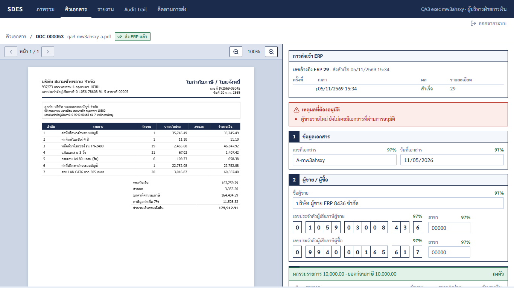

| ภาพรวม (หลังล็อกอิน) | คิวเอกสาร + อัปโหลด |
|---|---|
| 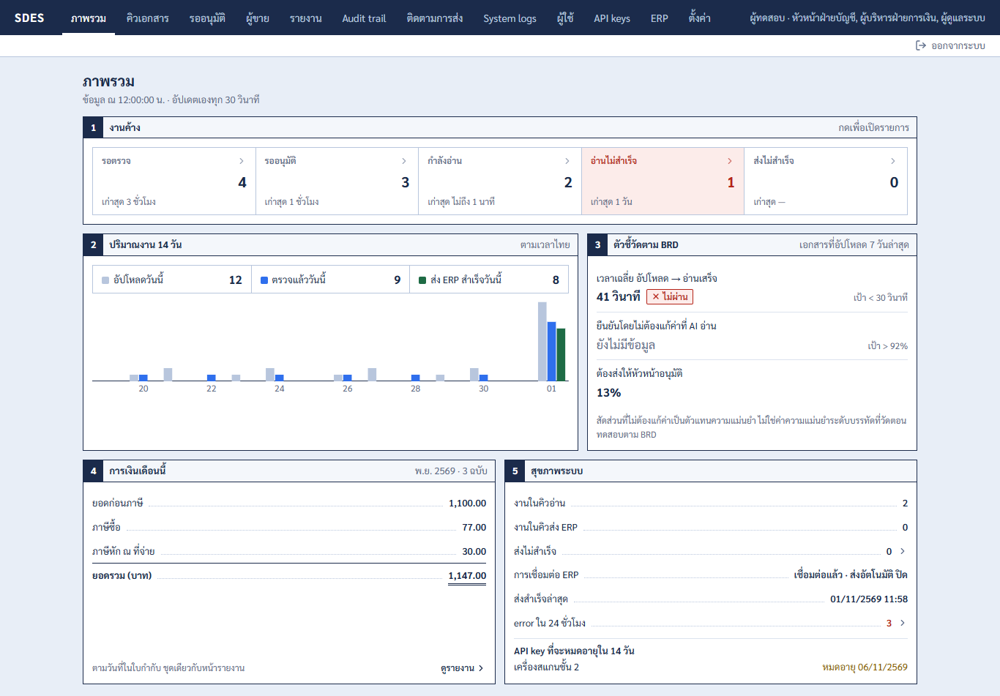 | 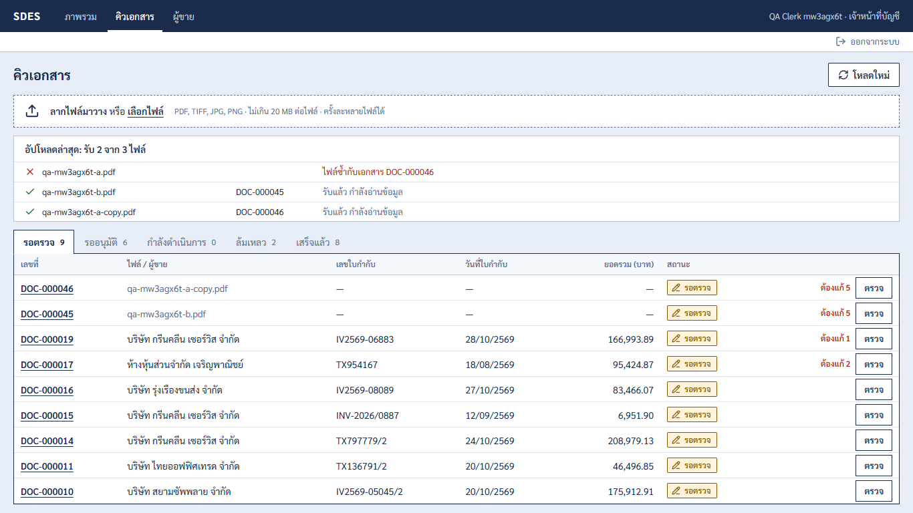 |
| งานค้าง, ปริมาณงาน 14 วัน, ตัวชี้วัดเทียบเป้า BRD, การเงิน, สุขภาพระบบ | อัปโหลดหลายไฟล์ (ไฟล์ซ้ำถูกปฏิเสธ), สถานะ real-time, จำนวนจุดที่ต้องแก้ |
| **คิวอนุมัติของ AP Lead** | **Audit trail** |
| 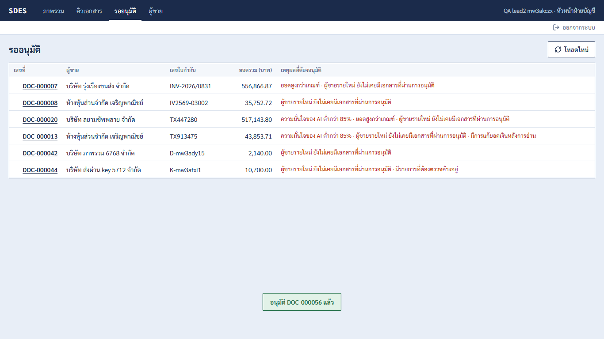 | 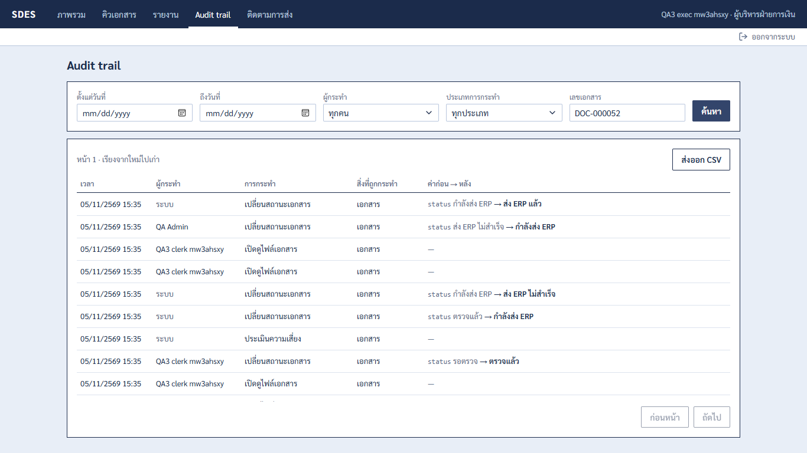 |
| เอกสารที่มีความเสี่ยงพร้อมเหตุผล | ทุกการกระทำพร้อมค่าก่อน → หลัง ส่งออก CSV ได้ |
| **รายงานการเงิน** | |
| 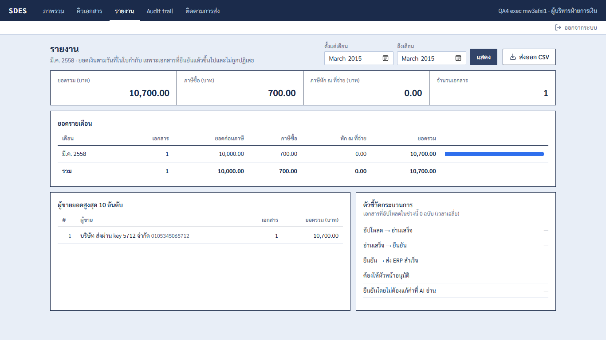 | |
| ยอดซื้อ ภาษีซื้อ หัก ณ ที่จ่าย รายเดือน, ผู้ขายยอดสูงสุด | |

---

## สารบัญ

1. [โครงสร้าง repo](#1-โครงสร้าง-repo)
2. [ผู้ใช้และสิทธิ์](#2-ผู้ใช้และสิทธิ์)
3. [สถาปัตยกรรมและ infra](#3-สถาปัตยกรรมและ-infra)
4. [Flow หลักของระบบ](#4-flow-หลักของระบบ)
5. [Tech stack](#5-tech-stack)
6. [เริ่มใช้งานบนเครื่อง](#6-เริ่มใช้งานบนเครื่อง)
7. [ความปลอดภัย](#7-ความปลอดภัย)
8. [เฟสของงาน (OpenSpec)](#8-เฟสของงาน-openspec)

---

## 1. โครงสร้าง repo

ระบบแบ่งเป็น 3 repo — repo นี้เป็น **repo วางแผน** ส่วนโค้ดอยู่ใน 2 repo ที่ผูกไว้เป็น **git submodule** ที่โฟลเดอร์ `Service/` และ `Web/` (ชี้ไปที่ commit ที่ทดสอบร่วมกันแล้ว)

| Repo | โฟลเดอร์ | เนื้อหา |
|---|---|---|
| **smart-document-extraction-erp-sync** (repo นี้) | `/` | BRD, spec และแผนงาน (OpenSpec), คู่มือ deploy, หลักฐานการทดสอบและ E2E ทั้งสาย |
| [**sdes-service**](https://github.com/sonniam04/sdes-service) | `Service/` | Backend: NestJS API, BullMQ worker, Prisma/PostgreSQL, docker compose (dev + prod), สคริปต์ deploy — [README](Service/README.md) |
| [**sdes-web**](https://github.com/sonniam04/sdes-web) | `Web/` | Frontend: Next.js 15 + Tailwind 4, หน้าตรวจเอกสารสองฝั่งด้วย PDF.js — [README](Web/README.md) |

```
.
├── docs/
│   ├── Business Requirements Document & Terms of Reference.pdf
│   └── deploy/                 คู่มือ deploy (README.md) + สร้าง VM บน Oracle Cloud (oci.md)
├── openspec/
│   ├── specs/                  spec ปัจจุบันของระบบ แยกตามความสามารถ (14 หมวด)
│   └── changes/                งานแต่ละเฟส: proposal / design / tasks (archive/ = เสร็จแล้ว)
├── qa/
│   ├── e2e/                    Playwright ตลอดสายกับ stack จริง + ภาพหลักฐาน
│   ├── extraction-eval/        ชุดเอกสารสังเคราะห์ + ตัววัดความแม่นยำของ AI
│   ├── demo/                   reset-dev.sh, seed-demo.mjs (ข้อมูลสาธิตบนเครื่อง dev)
│   └── phase1/ phase2/ ...     รายงานผลทดสอบและผลวัดของแต่ละเฟส
├── Service/                    ← submodule: sdes-service
└── Web/                        ← submodule: sdes-web
```

**ทำงานกับ submodule**

| ต้องการ | คำสั่ง |
|---|---|
| clone ครบทั้ง 3 repo | `git clone --recursive https://github.com/sonniam04/smart-document-extraction-erp-sync.git` |
| clone ไปแล้วแต่ `Service/` `Web/` ว่าง | `git submodule update --init` |
| ดึงโค้ดตามตำแหน่งที่ repo นี้ชี้ | `git pull && git submodule update` |
| อัปเดตตำแหน่งที่ชี้หลังมี commit ใหม่ใน Service/Web | commit + push ใน `Service/` หรือ `Web/` ก่อน → กลับมาที่ root → `git add Service Web && git commit` |

`Service/` และ `Web/` เป็น repo เต็มตัว — แก้โค้ด สร้าง branch และ push ในโฟลเดอร์นั้นได้ตามปกติ

ภายใน `Service/`:

| ส่วน | หน้าที่ |
|---|---|
| `apps/api` | REST API + socket.io — auth, ผู้ใช้, อัปโหลด, ตรวจ/อนุมัติ, ERP, รายงาน, audit, logs |
| `apps/worker` | คิว `extract` (อ่านเอกสารด้วย AI) และคิว `erp-sync` (ส่งเข้า ERP) |
| `packages/core` | กติกากลางที่ api, worker และเว็บใช้ร่วมกัน: สิทธิ์, state machine, กฎตรวจยอด, ความเสี่ยง, adapter ของ ERP |
| `packages/db` | Prisma schema, migration, seed, การเปลี่ยนสถานะ + audit ใน transaction เดียว |

---

## 2. ผู้ใช้และสิทธิ์

| Role | ทำอะไรได้ |
|---|---|
| **AP Clerk** (เจ้าหน้าที่บัญชีเจ้าหนี้) | อัปโหลด, ตรวจและแก้ข้อมูล, ยืนยันเอกสาร, สั่งอ่านใหม่เมื่อล้มเหลว, ดูทะเบียนผู้ขาย |
| **AP Lead** (หัวหน้าบัญชีเจ้าหนี้) | ทุกอย่างของ Clerk + **อนุมัติ/ปฏิเสธ** เอกสารที่มีความเสี่ยง |
| **Finance Exec** (ผู้บริหารการเงิน) | ดูเอกสาร, รายงานการเงิน, audit trail, สถานะคิวและการส่ง ERP (อ่านอย่างเดียว) |
| **System Admin** | ผู้ใช้, ค่าตั้ง, การเชื่อมต่อ ERP, API key, ส่ง ERP ใหม่, system logs, audit — **ไม่มีสิทธิ์เปิดเอกสารบัญชี** (แยกหน้าที่) |
| **API key** (ระบบภายนอก) | อัปโหลดและอ่านสถานะเอกสารเท่านั้น (`document.upload` / `document.read`) |

แหล่งความจริงของสิทธิ์อยู่ที่ `Service/packages/core/src/roles.ts` — API บังคับสิทธิ์ทุก route ส่วนเว็บใช้สำเนาเพื่อซ่อนเมนูเท่านั้น

---

## 3. สถาปัตยกรรมและ infra

### 3.1 ภาพรวมส่วนประกอบ

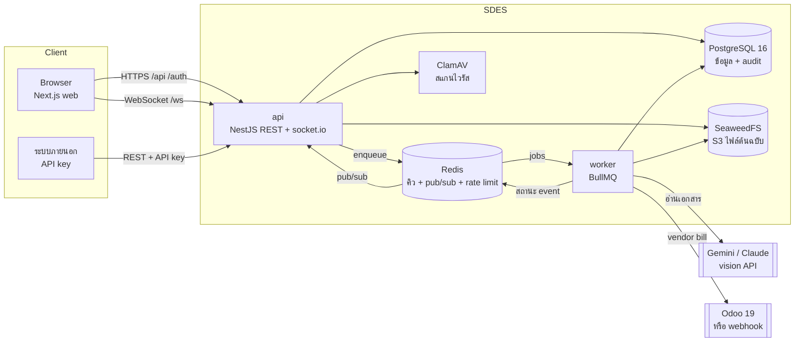

- **api** รับคำขอทั้งหมด ตรวจไฟล์ เก็บไฟล์ แล้วใส่งานลงคิว — ไม่เรียก AI หรือ ERP เอง (key ของ AI ส่งให้ worker เท่านั้น)
- **worker** ทำงานที่ช้าหรือพึ่งระบบภายนอก ลองใหม่อัตโนมัติ 3 ครั้งเมื่อล้มเหลวชั่วคราว
- **สถานะ real-time**: worker ประกาศ event ผ่าน Redis → api ส่งต่อทาง socket.io → คิวเอกสารในเว็บอัปเดตทันที
- **ทุกการเปลี่ยนสถานะ** เขียน `document_status_history` และ `audit_events` ใน transaction เดียวกัน; บัญชีฐานข้อมูลของแอป (`sdes_app`) แก้/ลบ audit ไม่ได้

### 3.2 Infra บนเครื่อง dev

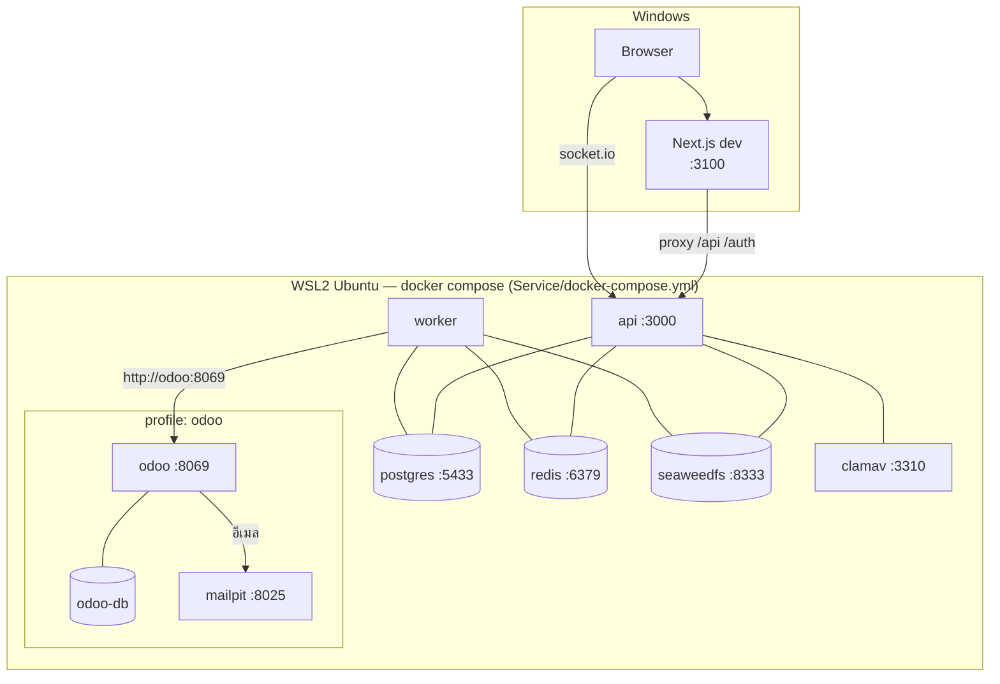

Odoo, ฐานของ Odoo และ Mailpit อยู่ใน compose profile `odoo` ใช้เป็น ERP ปลายทางสำหรับพัฒนาและ E2E

### 3.3 Infra บน production

เครื่องเดียว (ออกแบบสำหรับ Oracle Cloud Always Free — ARM 2 OCPU / 12 GB, Ubuntu 24.04) รันด้วย `Service/docker-compose.prod.yml` — **ค่าใช้จ่าย 0 บาท** (ไม่อัปเกรด PAYG, ใช้ IP ชั่วคราว + DuckDNS)

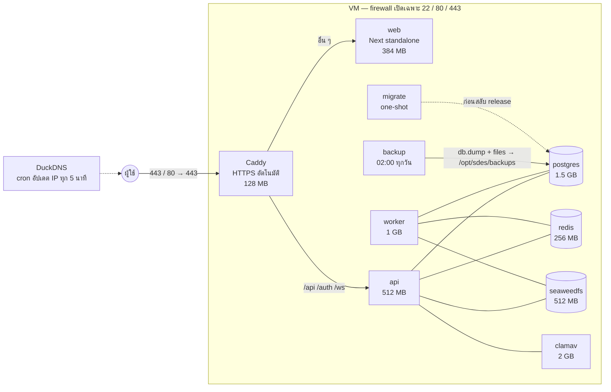

- ทุก container มี `mem_limit`, healthcheck และ log rotation — `deploy/check-budget.sh` ตรวจว่ารวมกันไม่เกิน 80% ของ RAM เครื่อง
- api/worker ตรวจค่าตั้งตอนเริ่มเมื่อ `NODE_ENV=production` — ค่าขาดหรือเป็นค่าตัวอย่างจะไม่ยอมเริ่ม
- คู่มือเต็ม: [docs/deploy/README.md](docs/deploy/README.md) และ [docs/deploy/oci.md](docs/deploy/oci.md)

### 3.4 Flow การ deploy

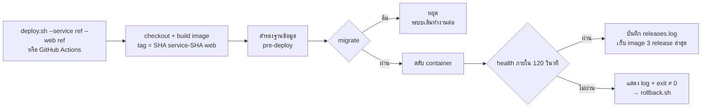

---

## 4. Flow หลักของระบบ

### 4.1 ภาพรวมตลอดสาย

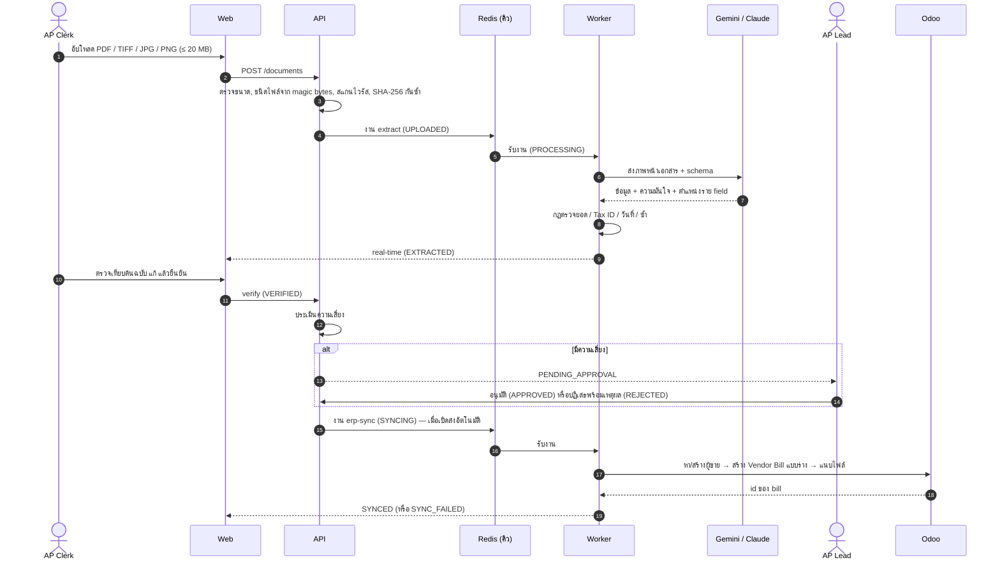

### 4.2 วงจรสถานะของเอกสาร

กำหนดใน `Service/packages/core/src/lifecycle.ts` — การเปลี่ยนสถานะนอกตารางนี้ถูกปฏิเสธเสมอ

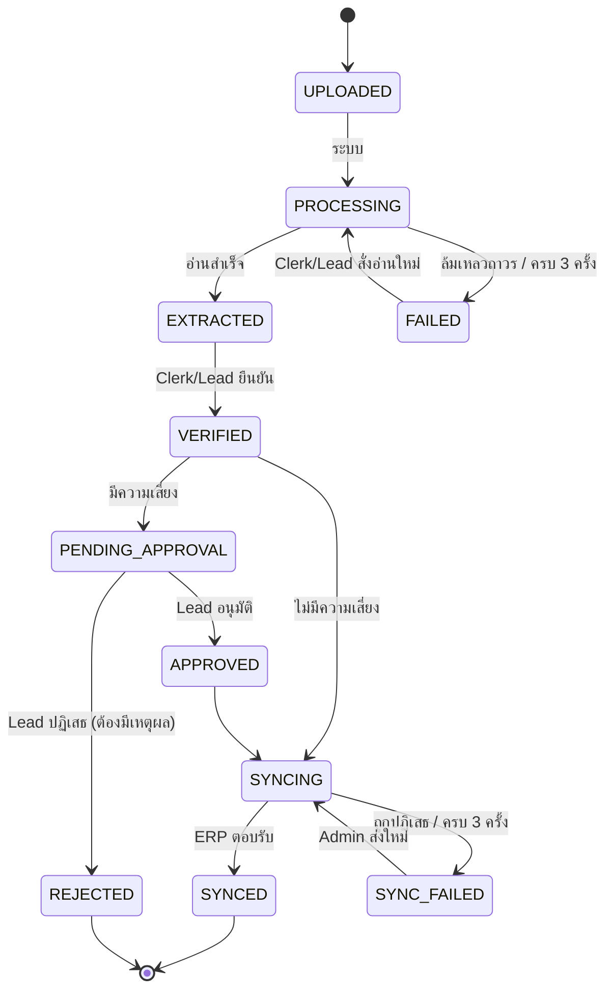

### 4.3 การรับไฟล์ (Ingest)

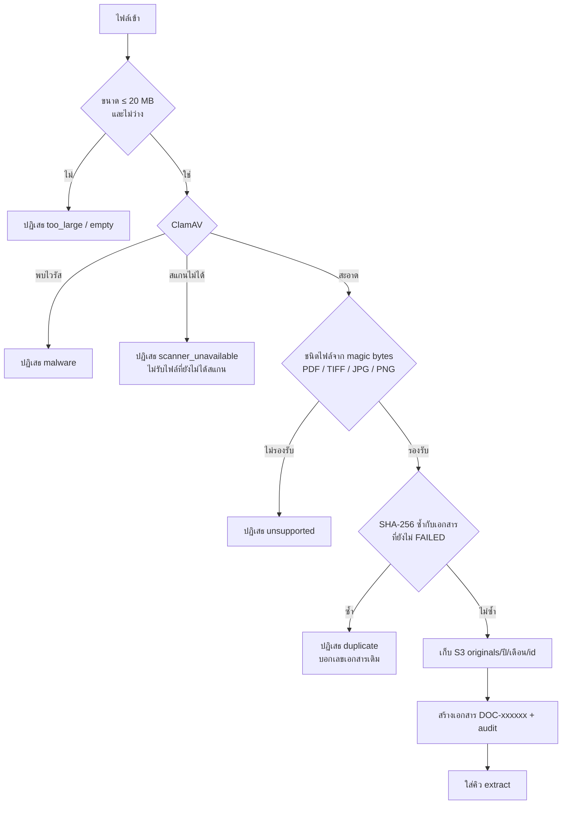

ทุกการปฏิเสธถูกบันทึกใน audit พร้อมเหตุผล อัปโหลดหลายไฟล์ได้ในคำขอเดียว ผลแยกรายไฟล์

### 4.4 การอ่านและตรวจข้อมูล

1. **อ่าน** — worker แปลง TIFF เป็น PNG ทีละหน้า ย่อภาพที่ใหญ่เกิน แล้วส่งให้ provider ที่ตั้งไว้ (`EXTRACTION_PROVIDER` = `gemini` / `claude` / `fixture` สำหรับทดสอบ / `fake` สำหรับสาธิต) ได้ค่าราย field พร้อมความมั่นใจและกรอบตำแหน่งบนหน้า
2. **ตรวจ** (`packages/core/src/validation.ts`) — กฎชุดเดียวกันรันทั้งที่ server และในหน้าเว็บขณะแก้:
   - Tax ID 13 หลัก (checksum), สาขา, Tax ID ผู้ซื้อตรงกับบริษัท
   - ยอดรายบรรทัด, ผลรวมบรรทัด, ฐาน VAT, VAT 7%, หัก ณ ที่จ่าย, ยอดสุทธิ — คลาดเคลื่อนได้ไม่เกิน ±0.01
   - วันที่ (รูปแบบ, ไม่อยู่ในอนาคต, ไม่เก่าเกิน), เลขใบกำกับซ้ำกับผู้ขายเดิม
3. **ลดความมั่นใจ** ของ field ที่ผิดกฎ เพื่อให้คนเห็นจุดที่ต้องดู

### 4.5 การตรวจทานและอนุมัติ

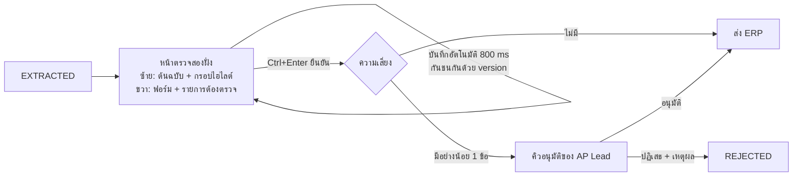

เหตุผลความเสี่ยง (`packages/core/src/risk.ts`):

| รหัส | เมื่อ |
|---|---|
| `LOW_CONFIDENCE` | มี field ที่ความมั่นใจต่ำกว่าเกณฑ์ (ค่าเริ่มต้น 0.85 — ตั้งได้) |
| `HIGH_AMOUNT` | ยอดรวมสูงกว่าเกณฑ์ที่ Admin ตั้ง |
| `NEW_VENDOR` | ผู้ขายยังไม่เคยมีเอกสารที่ผ่านการอนุมัติ |
| `MONEY_EDITED` | มีการแก้ยอดเงินหลังจาก AI อ่าน |
| `OPEN_WARNINGS` | ยังมีคำเตือนค้าง |

ผู้ที่ยืนยันหรือแก้เอกสารเองอนุมัติเอกสารนั้นไม่ได้ (แยกหน้าที่)

### 4.6 การส่งเข้า ERP

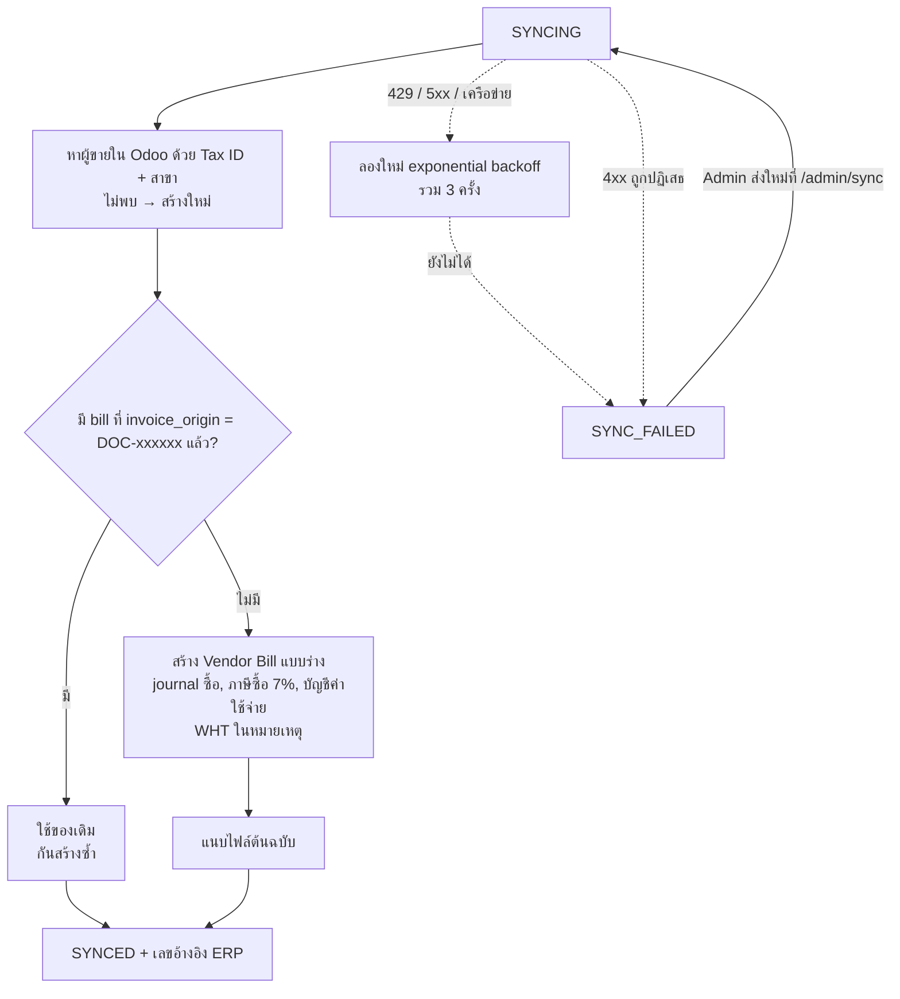

- ใบแจ้งหนี้สร้างเป็น **แบบร่าง** ฝ่ายบัญชีตรวจและ post ใน Odoo เอง
- ตั้งค่าที่หน้า `/admin/erp` — เปิดสวิตช์ส่งอัตโนมัติได้หลังทดสอบการเชื่อมต่อผ่าน และการแก้ค่าใด ๆ จะปิดสวิตช์จนกว่าจะทดสอบผ่านอีกครั้ง
- API key ของ ERP เข้ารหัสด้วย AES-256-GCM (`ERP_SECRET_KEY`) ไม่ถูกส่งกลับใน API, log หรือ audit
- ทางเลือกสำรอง: **webhook** ลงลายเซ็น HMAC-SHA256 พร้อม `Idempotency-Key` — รายละเอียดการตรวจลายเซ็นใน [Service/README.md](Service/README.md#ตรวจลายเซ็น-webhook-ฝั่งปลายทาง)
- ทุกครั้งที่ส่งเก็บใน `erp_sync_attempts` ดูได้ที่หน้าเอกสารและหน้าติดตามการส่ง

### 4.7 การยืนยันตัวตน

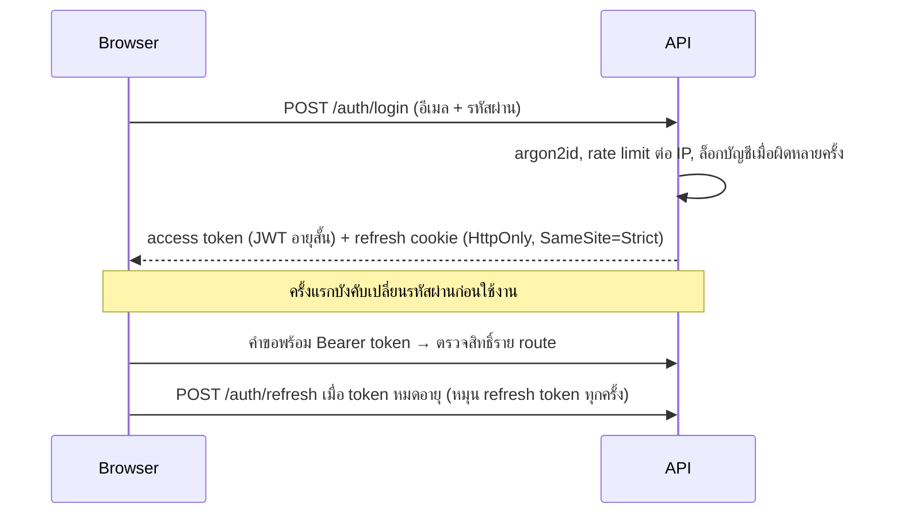

ระบบภายนอกใช้ API key (`Authorization: Bearer` หรือ `X-API-Key`) — เก็บแค่ hash, มีวันหมดอายุ, เพิกถอนได้ และแต่ละ key มีบัญชีบริการของตัวเองใน audit

---

## 5. Tech stack

| ชั้น | เทคโนโลยี |
|---|---|
| Frontend | Next.js 15 (App Router), React, Tailwind CSS 4, PDF.js, socket.io-client, Playwright, Vitest |
| Backend | Node.js 22, NestJS, socket.io, BullMQ, Prisma, Swagger (`/docs`) |
| ข้อมูล | PostgreSQL 16, Redis 7, SeaweedFS (S3-compatible) |
| ความปลอดภัยไฟล์ | ClamAV, ตรวจ magic bytes, SHA-256 |
| AI | Google Gemini (`gemini-3-flash-preview` บน free tier) หรือ Anthropic Claude (vision) |
| ERP | Odoo 19 Community + `l10n_th` ผ่าน JSON-2 (รองรับ JSON-RPC สำหรับ 17–18), webhook |
| Infra | Docker Compose, Caddy (HTTPS อัตโนมัติ), Oracle Cloud Always Free, DuckDNS, GitHub Actions |
| เครื่องมือ | pnpm workspaces, OpenSpec, k6 (load test) |

---

## 6. เริ่มใช้งานบนเครื่อง

ต้องมี Node.js 22+, pnpm 10 (`corepack enable`), Docker Engine + Compose v2 (บน Windows ใช้ Docker ใน WSL ได้) และ RAM ว่างราว 4 GB

```bash
# 1. clone ทั้ง 3 repo (submodule มาพร้อมกัน)
git clone --recursive https://github.com/sonniam04/smart-document-extraction-erp-sync.git sdes
cd sdes

# 2. backend — สร้าง .env, เปิด stack, migrate + สร้าง Admin คนแรก
cd Service && pnpm install
#    (ดูคำสั่งสร้าง .env แบบสุ่มรหัสใน Service/README.md)
docker compose --profile odoo up -d --build --wait
pnpm build && pnpm --filter @sdes/db migrate:deploy && pnpm --filter @sdes/db seed
curl http://127.0.0.1:3000/health

# 3. Odoo สำหรับ dev — พิมพ์ API key และ id ที่ต้องใส่ในหน้า /admin/erp
sh docker/odoo/setup.sh

# 4. frontend
cd ../Web && pnpm install && pnpm dev --port 3100
```

เปิด http://127.0.0.1:3100 แล้วล็อกอินด้วย `SEED_ADMIN_EMAIL` / `SEED_ADMIN_PASSWORD` ใน `Service/.env` → เปลี่ยนรหัสผ่าน → สร้างผู้ใช้แต่ละ role → ตั้งค่าบริษัท (Tax ID) และ ERP

| บริการ | URL |
|---|---|
| เว็บ | http://127.0.0.1:3100 |
| API + Swagger | http://127.0.0.1:3000 · http://127.0.0.1:3000/docs |
| Odoo | http://127.0.0.1:8069 |
| Mailpit | http://127.0.0.1:8025 |

ล้างข้อมูลทั้งหมดบนเครื่อง dev: `qa/demo/reset-dev.sh` (รายละเอียดในหัวไฟล์) — **ห้ามรันกับ production**

รายละเอียดเพิ่มเติม: [Service/README.md](Service/README.md) (environment, AI provider, ERP, API key, test) · [Web/README.md](Web/README.md) (หน้าเว็บ, หน้าตรวจ, test)

---

## 7. ความปลอดภัย

- **ไฟล์:** สแกนไวรัสก่อนเก็บ ตรวจชนิดจากเนื้อไฟล์ไม่ใช่นามสกุล เก็บใน S3 (production เปิด SSE) และเปิดดูผ่าน API ที่ตรวจสิทธิ์เท่านั้น
- **สิทธิ์:** ตรวจที่ API ทุก route — มี regression test ไล่ทุก route ถ้าลืมใส่สิทธิ์ test จะล้ม
- **แยกหน้าที่:** Admin ไม่เห็นเอกสารบัญชี, คนแก้/ยืนยันอนุมัติเอกสารตัวเองไม่ได้
- **Audit:** append-only (trigger + บัญชีแอปไม่มีสิทธิ์แก้/ลบ) บันทึกค่าก่อน/หลัง ค้นและส่งออก CSV ได้
- **Secret:** API key ของ ERP เข้ารหัส, API key ของระบบภายนอกเก็บเป็น hash, log ปิดบัง token / รหัสผ่าน / เลข 13 หลักก่อนบันทึก
- **เครือข่าย:** rate limit (Redis), helmet + CSP, production เปิดแค่ 22/80/443 และ HTTPS เท่านั้น
- **Dependency:** CI ล้มเมื่อพบช่องโหว่ระดับ critical (`pnpm audit:gate`)
- **ข้อมูลที่ออกนอกระบบ:** ส่งเฉพาะไฟล์เอกสารให้ AI provider ไม่ส่งข้อมูลผู้ใช้ — Gemini free tier อาจนำข้อมูลไปใช้ปรับปรุงผลิตภัณฑ์ **ใช้กับเอกสารตัวอย่างเท่านั้น**

---

## 8. เฟสของงาน (OpenSpec)

| เฟส | เนื้อหา |
|---|---|
| Phase 1 | สถาปัตยกรรม, schema, auth/RBAC, อัปโหลด + สแกน, design system |
| Phase 2 | อ่านด้วย AI, กฎตรวจ, ความเสี่ยง, หน้าตรวจสองฝั่ง, อนุมัติ |
| Phase 3 | เชื่อม ERP (Odoo + webhook), ติดตามการส่ง, audit, E2E |
| ฟีเจอร์เพิ่ม | API key, system logs, ทะเบียนผู้ขาย, รายงาน, หน้าภาพรวม |
| Phase 4 | optimize + deploy บน hosting ฟรี |
